<p align="center">
  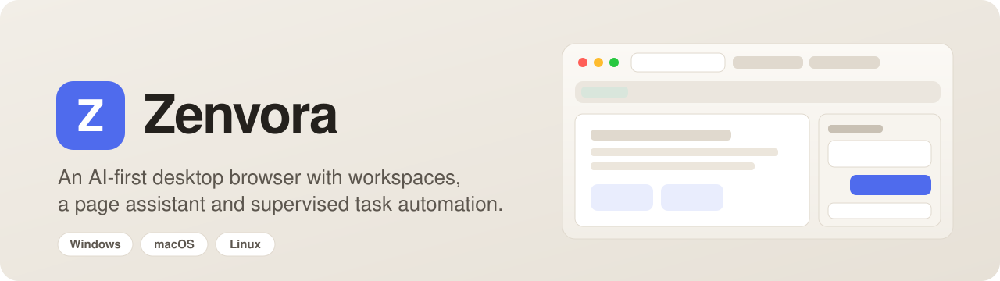
</p>

<p align="center">
  <a href="https://github.com/Mostafijemon24/Zenvora-Browser/actions/workflows/ci.yml"></a>
  <a href="https://github.com/Mostafijemon24/Zenvora-Browser/releases/latest"></a>
  
  
  
  
  
  
</p>

<p align="center">
  <a href="#-download">Download</a> ·
  <a href="#-quick-start">Quick start</a> ·
  <a href="#-features">Features</a> ·
  <a href="#-ai-assistant-setup">AI setup</a> ·
  <a href="#-api-integration">API integration</a> ·
  <a href="#-hosting-the-web-preview">Hosting</a> ·
  <a href="#-going-live">Going live</a> ·
  <a href="#-user-guide">User guide</a>
</p>

**Zenvora** is a desktop web browser built around how people actually research and work online. Tabs live in
named workspaces, a built-in assistant reads only the pages you choose to share, and a task engine turns a plain
request ("compare these five pricing pages and give me a CSV") into a step-by-step plan that runs only after you
approve it. It runs on Windows, macOS and Linux from a single codebase, and the same interface also runs in an
ordinary web browser as a hosted preview.

<p align="center">
  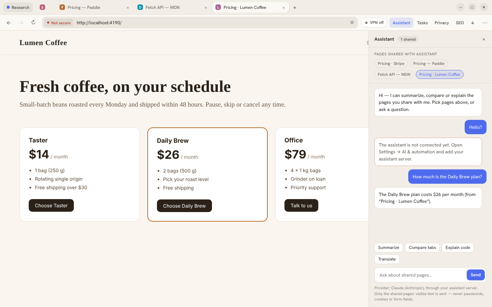
</p>

> [!NOTE]
> **Project status: early preview (v0.2).** Browsing, tabs, workspaces, the desktop shell and the **AI Assistant**
> (Claude or OpenRouter, through your own server) are working. Tasks, VPN, Privacy details, Page analysis and
> Downloads still run on sample data behind service interfaces ([see API integration](#-api-integration)).
> The app always says so on screen, and the VPN never claims to protect traffic it isn't protecting.

---

## Contents

- [Why Zenvora](#-why-zenvora)
- [Features](#-features)
- [Screenshots](#-screenshots)
- [Download](#-download)
- [Quick start](#-quick-start)
- [Project structure](#-project-structure)
- [Configuration](#%EF%B8%8F-configuration)
- [AI assistant setup](#-ai-assistant-setup)
- [API integration](#-api-integration)
- [Hosting the web preview](#-hosting-the-web-preview)
- [Going live](#-going-live)
- [User guide](#-user-guide)
- [Architecture](#-architecture)
- [Security](#-security)
- [Development](#-development)
- [Troubleshooting](#-troubleshooting)
- [Known limitations](#%EF%B8%8F-known-limitations)
- [Roadmap](#-roadmap)
- [Contributors](#-contributors)
- [License](#-license)

---

## 💡 Why Zenvora

Most browsers treat AI as a chat box bolted onto the side. Zenvora treats it as part of the browser, with clear rules:

- **You decide what the assistant sees.** Pages are shared one by one, shown as chips at the top of the panel. Passwords, cookies and form fields are never sent.
- **Automation asks first.** Every task produces a written plan and a list of exactly what it will touch. Nothing runs until you click *Approve & run*, and you can pause or stop it at any step, with a full audit trail afterwards.
- **No fake status.** If a feature isn't connected, the interface says so. Security indicators reflect the real connection; plain `http://` pages are never shown as secure.
- **Workspaces, not tab chaos.** Keep *Research*, *Client work* and *Personal* tabs apart, and jump to any tab in any workspace with ⌘/Ctrl + K.

---

## ✨ Features

Legend: ✅ working · 🧪 preview with sample data (interface ready, backend pending)

### Browsing

| | Feature | Details |
|:-:|---|---|
| ✅ | Real web browsing | Each tab runs in its own sandboxed Chromium view (desktop app) |
| ✅ | Smart address bar | Tells URLs from searches; DuckDuckGo, Google, Bing or Brave |
| ✅ | History per tab | Back, forward, reload, stop; redirects don't break the back button |
| ✅ | Tabs | New, close, reopen closed (last 10), mute audio, middle-click to close |
| ✅ | Workspaces | Separate tab sets for Research, Client work and Personal |
| ✅ | Tab search | Search titles and URLs across every workspace, including recently closed tabs |
| ✅ | Find in page | Live match count, Enter / Shift+Enter to step through matches |
| ✅ | Zoom | Per-tab zoom from 50% to 200%, with a reset chip in the address bar |
| ✅ | Error pages | Clear pages for unreachable sites and certificate problems, with the engine's real error code |
| ✅ | Links that open new windows | Become new tabs instead of pop-ups |

### Interface

| | Feature | Details |
|:-:|---|---|
| ✅ | Horizontal or vertical tabs | Switch any time in Settings |
| ✅ | Light, dark or system theme | System mode follows the OS live |
| ✅ | Accent colors | Blue, teal, ember or violet |
| ✅ | Native window controls | macOS traffic lights; drawn caption buttons on Windows and Linux |
| ✅ | Keyboard shortcuts | Through the app menu, so they work even while a page has focus |
| ✅ | Bundled fonts | No font CDN requests at startup |
| ✅ | Saved settings | Theme, layout, search engine and privacy toggles persist between launches |

### AI, automation and privacy

| | Feature | Details |
|:-:|---|---|
| ✅ | Assistant panel | Real answers from **Claude** or **OpenRouter** (any model) through your own server; reads the text of the pages you share and remembers the conversation |
| 🧪 | Tasks (automation) | Plan → approval → run → result, with pause/resume, stop and audit trail |
| 🧪 | Privacy panel | Per-site permission controls and tracking protection levels (the engine currently denies all permissions) |
| 🧪 | Page analysis (SEO) | Title, meta, headings, links, structured data checks; JSON and CSV export works |
| 🧪 | Downloads panel | Progress, pause/resume, unverified-executable hold; browser downloads themselves save normally |
| 🧪 | VPN | Shows *Not set up* in the desktop app; WireGuard import is planned |
| ✅ | Local model detection | Settings → AI checks for an Ollama-compatible server at `localhost:11434` |

---

## 🖼 Screenshots

| | |
| :---: | :---: |
| 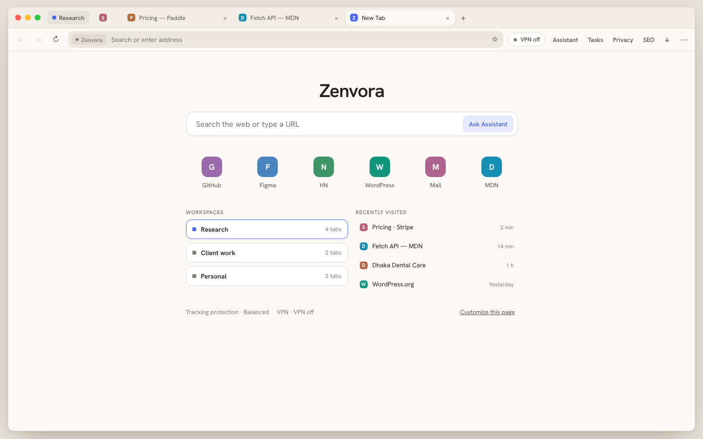<br>**New tab:** search, shortcuts, workspaces and recent pages | 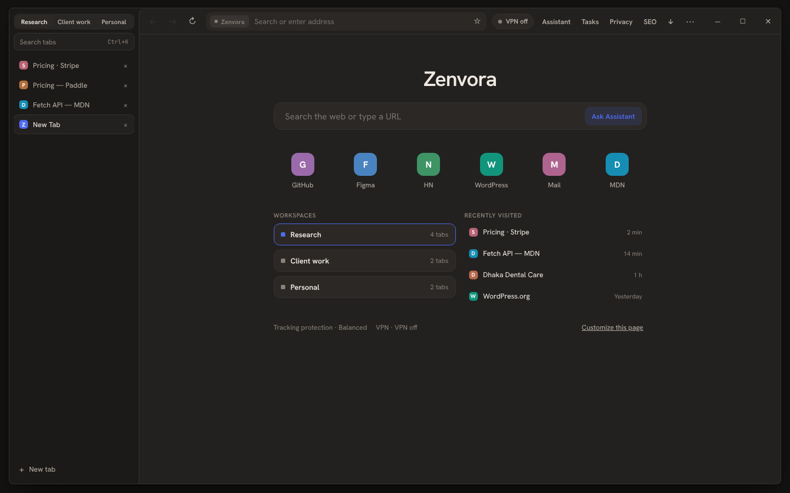<br>**Vertical tabs** in dark mode (Windows layout) |
| 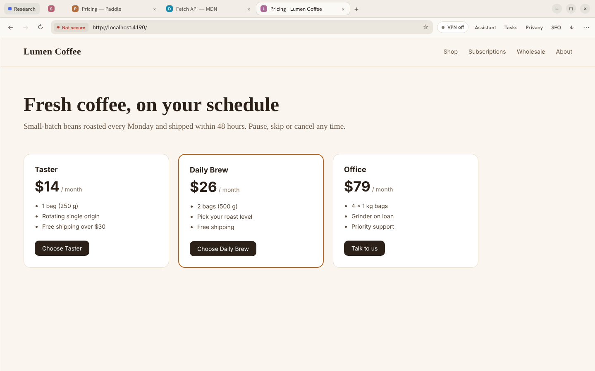<br>**Desktop app:** real page rendering, *Not secure* on plain http | 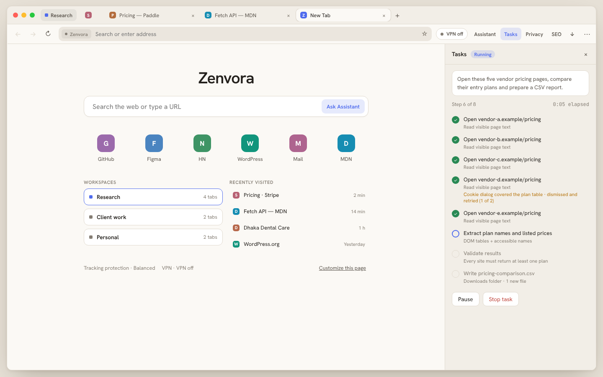<br>**Tasks:** approved plan running step by step, with recovery notes |
| 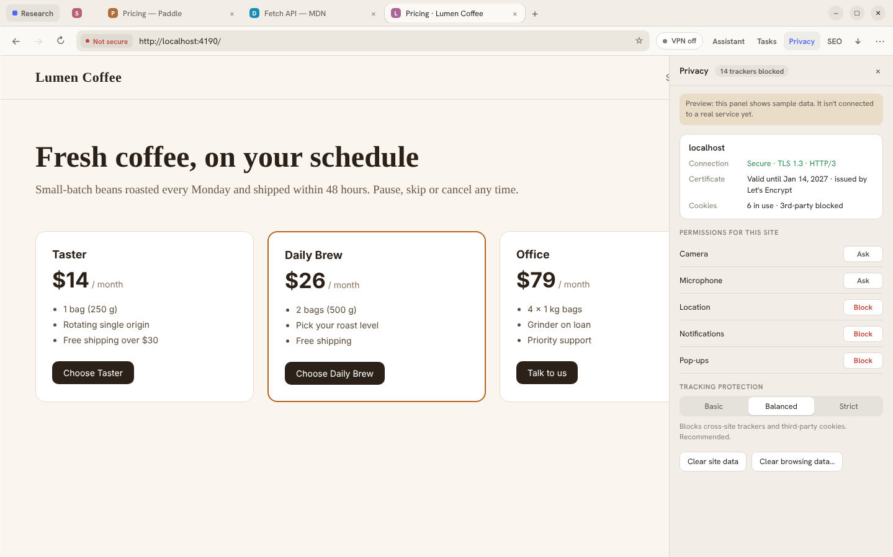<br>**Privacy:** connection details, per-site permissions, tracking protection | 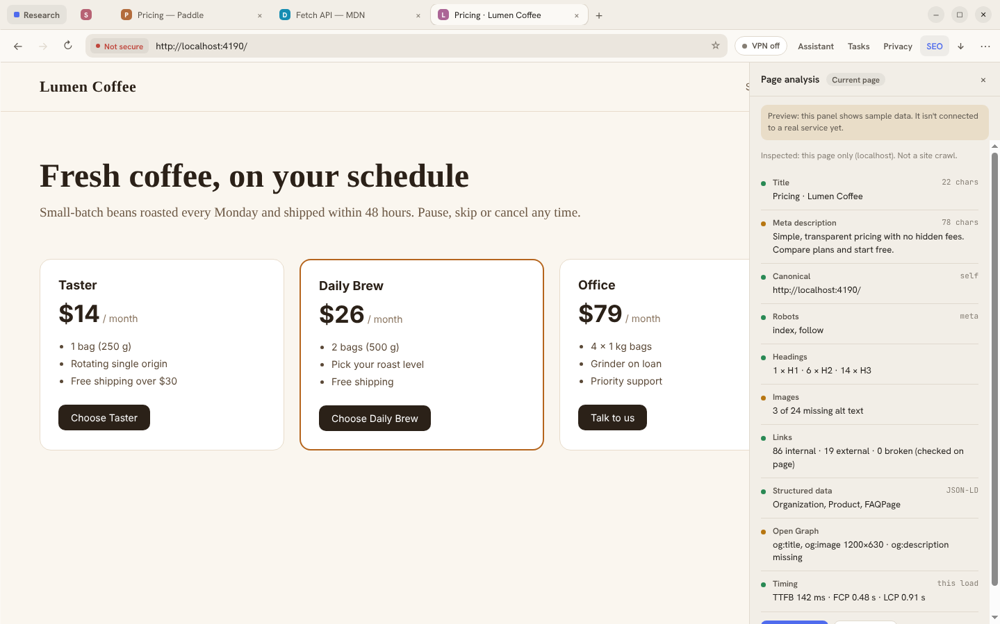<br>**Page analysis:** on-page SEO checks with JSON/CSV export |
| 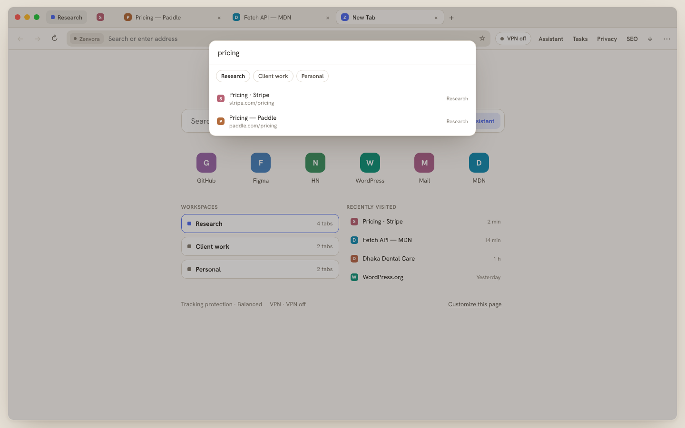<br>**Tab search:** every workspace plus recently closed tabs | 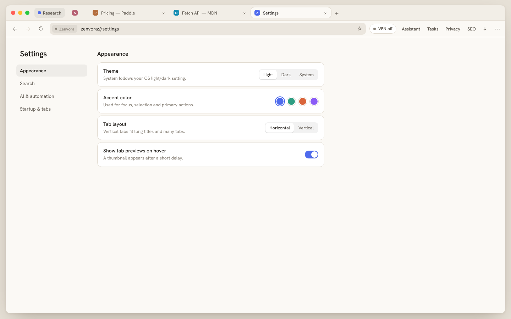<br>**Settings:** theme, accent color, tab layout |
| 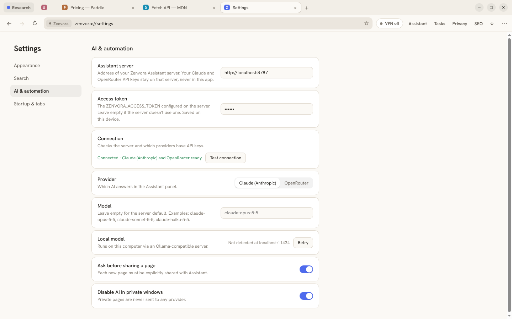<br>**AI settings:** connect your server, pick Claude or OpenRouter and a model | <br>**Assistant:** answers from the text of the pages you share |
| 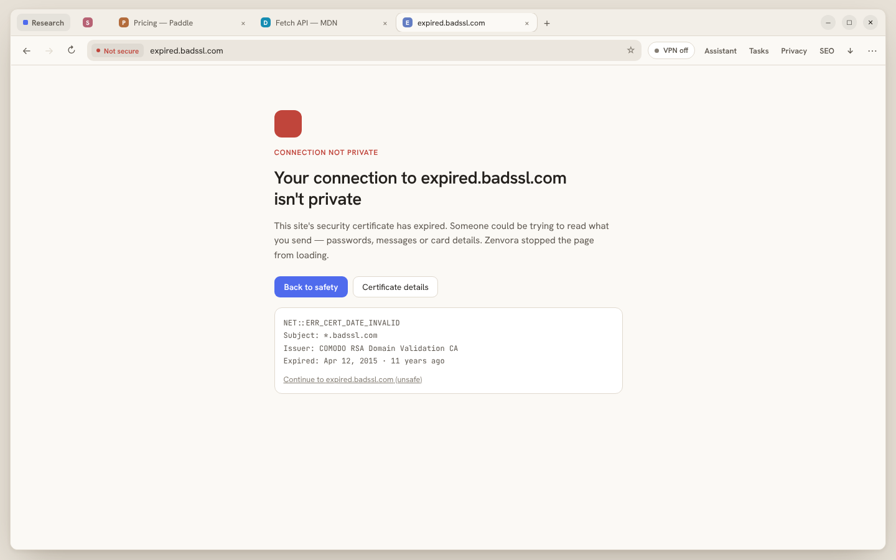<br>**Certificate errors:** blocked by default, details on request | 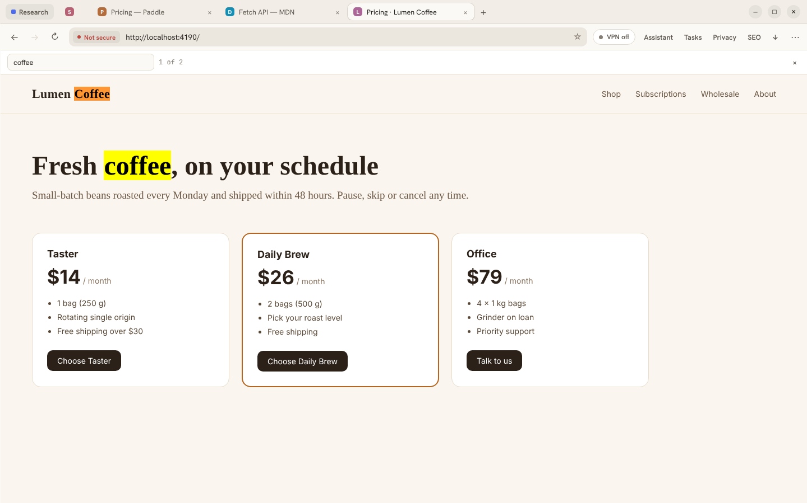<br>**Find in page:** real matches highlighted in the page |
| 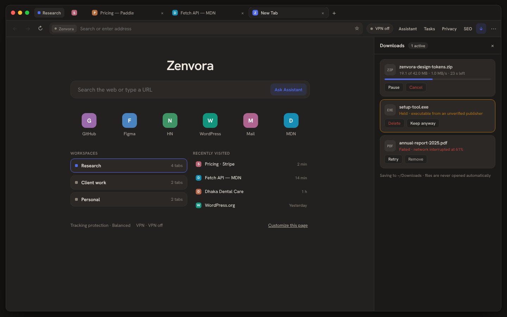<br>**Downloads:** progress, held executables, retry | 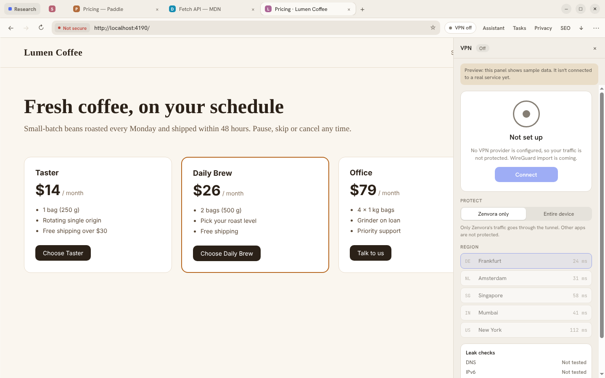<br>**Honest VPN status:** never claims protection it doesn't provide |

<p align="center">
  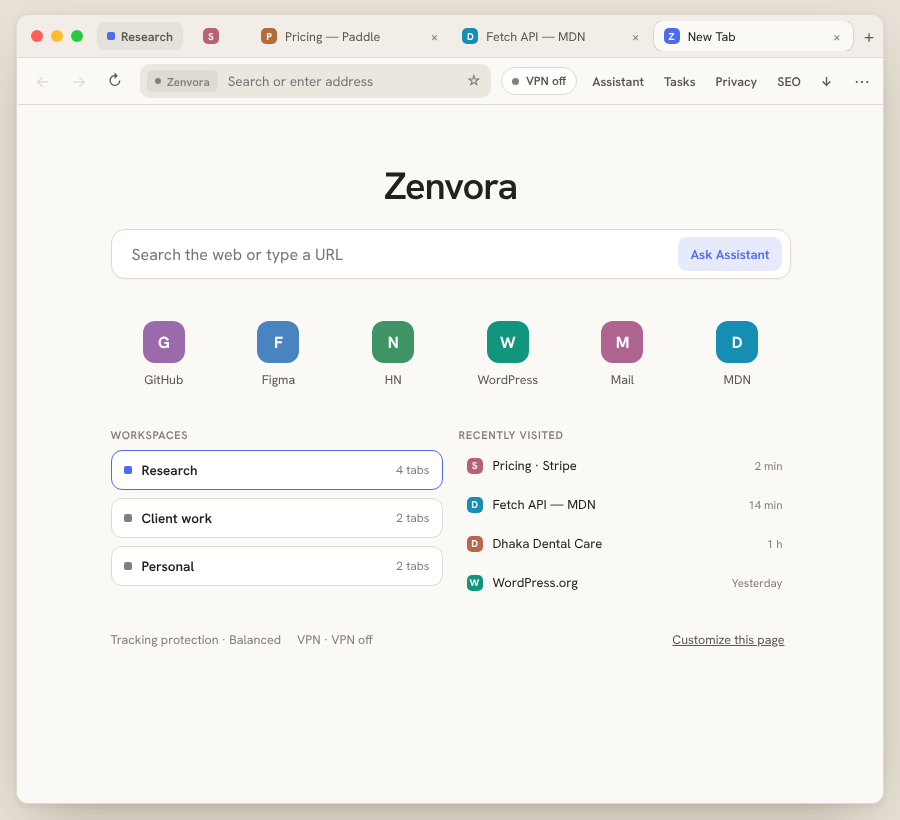
  <br><em>Narrow windows fold secondary controls into the ⋯ menu.</em>
</p>

---

## 📦 Download

Get the latest installers from the **[Releases page](https://github.com/Mostafijemon24/Zenvora-Browser/releases/latest)**.

| System | File | Notes |
|---|---|---|
| Windows 10 / 11 (64-bit) | `Zenvora-Setup-<version>-x64.exe` | Installer; you can choose the install folder |
| macOS, Apple Silicon (M1–M4) | `Zenvora-<version>-mac-arm64.dmg` | Drag Zenvora to Applications |
| macOS, Intel | `Zenvora-<version>-mac-x64.dmg` | Drag Zenvora to Applications |
| Linux, any distribution | `Zenvora-<version>-linux-x86_64.AppImage` | `chmod +x` then run |
| Debian / Ubuntu | `Zenvora-<version>-linux-amd64.deb` | `sudo apt install ./Zenvora-*.deb` |

Every release also includes `SHA256SUMS.txt`. Verify a download with `sha256sum -c SHA256SUMS.txt --ignore-missing` (Linux/macOS) or `Get-FileHash <file>` (PowerShell).

### First launch of an unsigned build

Releases are not code-signed yet, so the operating system warns you once:

- **Windows:** on *Windows protected your PC*, click **More info → Run anyway**.
- **macOS:** open Zenvora once. When macOS blocks it, open **System Settings → Privacy & Security** and click **Open Anyway**.
- **Linux AppImage:** `chmod +x Zenvora-*.AppImage && ./Zenvora-*.AppImage`. On distributions without FUSE 2, install `libfuse2` (Ubuntu 22.04+: `sudo apt install libfuse2`).

[Going live](#-going-live) explains how to add signing so these warnings disappear.

---

## 🚀 Quick start

### Requirements

- **Node.js 22 LTS** and npm 10 or newer
- Git
- For desktop packaging: the target OS (a `.dmg` must be built on macOS; Windows and Linux builds work on their own systems or in CI)

### Run locally

```bash
git clone https://github.com/Mostafijemon24/Zenvora-Browser.git
cd Zenvora-Browser/app
npm install

npm run dev        # web preview with hot reload → http://localhost:5173
npm run electron   # build, then open the desktop app
```

For hot reload inside the desktop app, run the two commands below in separate terminals:

```bash
npm run dev
npm run electron:dev   # loads the UI from http://localhost:5173
```

### All scripts

Run from the `app/` folder.

| Command | What it does |
|---|---|
| `npm run dev` | Web preview with hot module reload |
| `npm run build` | Typecheck, then production build of the UI into `dist/` |
| `npm run preview` | Serve the production build locally |
| `npm test` | Unit tests (Vitest) |
| `npm run typecheck` | TypeScript check only |
| `npm run electron` | Build the UI and launch the desktop app |
| `npm run electron:dev` | Desktop app against the running dev server |
| `npm run dist` | Installers for the current OS into `release/` |
| `npm run dist:linux` / `dist:win` / `dist:mac` | Installers for one platform |

---

## 🗂 Project structure

```
Zenvora-Browser/
├── app/
│   ├── electron/
│   │   ├── main.cjs            # desktop shell: window, menu, web content hardening
│   │   └── preload.cjs         # small, fixed bridge API exposed to the UI
│   ├── src/
│   │   ├── components/
│   │   │   ├── chrome/         # window, tab strip, sidebar, toolbar, menu, tab search
│   │   │   ├── pages/          # new tab, web views, error pages, settings
│   │   │   ├── panels/         # assistant, tasks, VPN, privacy, page analysis, downloads
│   │   │   └── ui/             # segmented control, toggle, favicon, window controls
│   │   ├── lib/                # URL parsing, native bridge, file export
│   │   ├── services/           # service interfaces + sample implementations
│   │   ├── state/              # tabs reducer, settings, feature state, BrowserProvider
│   │   ├── styles/             # design tokens (light/dark, accents) and component CSS
│   │   └── __tests__/          # unit tests
│   ├── build/icon.png          # app icon used for every platform
│   ├── RELEASE_NOTES.md        # text published with each GitHub release
│   └── package.json            # scripts, dependencies and installer settings
├── server/                     # AI assistant server (holds the Claude / OpenRouter keys)
│   ├── server.mjs              # HTTP API: /health, /api/providers, /api/assistant
│   ├── providers.mjs           # Claude (official SDK) and OpenRouter
│   ├── test/                   # tests against fake providers
│   ├── .env.example            # every setting, documented
│   └── Dockerfile
├── .github/workflows/
│   ├── ci.yml                  # tests and build on every push / pull request
│   └── release.yml             # builds installers on Windows, macOS, Linux and publishes a release
└── docs/                       # README images
```

---

## ⚙️ Configuration

### Preview URL options (web preview)

| Query string | Effect |
|---|---|
| `?demo=0` | Hide the preview bar above the window |
| `?platform=mac\|win\|linux` | Window controls and shortcut labels |
| `?layout=top\|side` | Horizontal or vertical tabs |
| `?theme=light\|dark\|system` | Theme |
| `?accent=blue\|teal\|ember\|violet` | Accent color |

Example: `http://localhost:5173/?demo=0&platform=win&layout=side&theme=dark`

The preview bar also has buttons that open the DNS and certificate error pages for demonstration.

### Environment variables

| Variable | Used by | Purpose |
|---|---|---|
| `ZENVORA_DEV_URL` | Desktop app | Load the UI from a dev server instead of `dist/` (set by `npm run electron:dev`) |
| `CSC_LINK`, `CSC_KEY_PASSWORD` | Packaging | Code-signing certificate (see [Going live](#-going-live)) |
| `APPLE_ID`, `APPLE_APP_SPECIFIC_PASSWORD`, `APPLE_TEAM_ID` | Packaging (macOS) | Notarization |
| `GH_TOKEN` | Packaging | Only if you publish with `electron-builder --publish`; the release workflow uses its built-in token |

### User settings

Settings are saved in the app's local storage under `zenvora.settings.v1`. The desktop app keeps browsing data
(cookies, cache, site storage) in its own persistent session named `persist:zenvora`, inside the OS user-data folder:

| OS | Location |
|---|---|
| Windows | `%APPDATA%\Zenvora` |
| macOS | `~/Library/Application Support/Zenvora` |
| Linux | `~/.config/Zenvora` |

Delete that folder to reset Zenvora completely.

### Installer settings

Installer options live in the `build` section of [`app/package.json`](app/package.json): app ID, product name,
file names, targets (`nsis`, `dmg` for arm64 and x64, `AppImage`, `deb`) and the publish target.

### Content Security Policy

The built UI ships with a strict policy, set in [`app/vite.config.ts`](app/vite.config.ts):

```
default-src 'self'; script-src 'self'; style-src 'self' 'unsafe-inline';
img-src 'self' data:; font-src 'self' data:;
connect-src 'self' https: http://localhost:* http://127.0.0.1:*;
object-src 'none'; base-uri 'none'
```

`connect-src` allows HTTPS (your assistant server) and local addresses (a server or model on the same machine).
Tighten it to your exact server origin if you ship a build for a single deployment.

---

## 🤖 AI assistant setup

The Assistant answers questions about the pages you share, using **Claude** (Anthropic) or any model on
**OpenRouter**. Your API keys live on a small server you run, never inside the app, so they can't be extracted
from an installer.

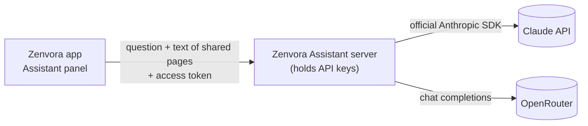

1. You share one or more tabs (chips at the top of the Assistant panel) and ask a question.
2. The desktop app reads the **visible text** of those pages (up to 20,000 characters each, at most 6 pages).
   Form values, passwords, cookies and storage are never read.
3. The app sends the question, the page text and the recent conversation to your server.
4. The server adds the system prompt (which tells the model to treat page text as untrusted), calls the chosen
   provider and returns the answer.

Without a server, the desktop app says the Assistant isn't connected instead of inventing answers; the web preview
shows sample replies.

### 1. Get an API key

You need at least one:

| Provider | Where | Notes |
|---|---|---|
| Claude (Anthropic) | [platform.claude.com](https://platform.claude.com/) → API keys | Default model `claude-opus-5-5`; pay per use |
| OpenRouter | [openrouter.ai/keys](https://openrouter.ai/keys) | One key for many vendors' models; buy credits first. Default `openrouter/auto` picks a model per request |

### 2. Run the server locally

```bash
cd server
npm install
cp .env.example .env
```

Edit `.env`:

```bash
ANTHROPIC_API_KEY=sk-ant-...          # and/or
OPENROUTER_API_KEY=sk-or-...
ZENVORA_ACCESS_TOKEN=$(openssl rand -hex 32)   # paste the generated value
```

```bash
npm run start:env
# Zenvora Assistant server on http://0.0.0.0:8787  (Claude (Anthropic): ready · OpenRouter: ready)
```

Check it: `curl http://localhost:8787/health` → `{"ok":true}`.

### 3. Connect the app

Open **⋯ → Settings → AI & automation**:

1. **Assistant server:** `http://localhost:8787` (or your deployed `https://` address).
2. **Access token:** the `ZENVORA_ACCESS_TOKEN` value.
3. Click **Test connection**. You should see *Connected · Claude (Anthropic) and OpenRouter ready* (or whichever has a key).
4. **Provider:** Claude (Anthropic) or OpenRouter.
5. **Model:** leave empty for the server default, or enter a model ID, for example `claude-sonnet-5-5` for Claude,
   or any ID from [openrouter.ai/models](https://openrouter.ai/models) such as `meta-llama/llama-3.3-70b-instruct`.

Open the **Assistant** panel; the line under the input shows which provider answers.

### Server settings

All settings are environment variables (see [`server/.env.example`](server/.env.example)).

| Variable | Default | Purpose |
|---|---|---|
| `ANTHROPIC_API_KEY` | — | Enables Claude |
| `ANTHROPIC_MODEL` | `claude-opus-5-5` | Default Claude model |
| `ANTHROPIC_EFFORT` | `low` | `low`, `medium` or `high`: deeper reasoning is slower and costs more |
| `OPENROUTER_API_KEY` | — | Enables OpenRouter |
| `OPENROUTER_MODEL` | `openrouter/auto` | Default OpenRouter model |
| `DEFAULT_PROVIDER` | first provider with a key | Used when the app doesn't specify one |
| `ZENVORA_ACCESS_TOKEN` | — | Shared secret the app must send. **Set it on any server reachable from the internet** |
| `ALLOWED_ORIGINS` | `*` | Comma-separated browser origins allowed by CORS. The desktop app sends `null` |
| `RATE_LIMIT_PER_MINUTE` | `30` | Assistant requests per minute per IP address |
| `PORT` / `HOST` | `8787` / `0.0.0.0` | Listen address |

Claude requests use the official Anthropic SDK with server-side fallbacks enabled, so if the model declines a
request the API retries it on a fallback model automatically.

### 4. Deploy the server

Any host that runs Node.js 22 works. Always serve it over **HTTPS** and set `ZENVORA_ACCESS_TOKEN`.

**Option A: a VPS (DigitalOcean, Hetzner, Lightsail…)**

```bash
# on the server (Ubuntu)
curl -fsSL https://deb.nodesource.com/setup_22.x | sudo -E bash - && sudo apt install -y nodejs nginx
git clone https://github.com/Mostafijemon24/Zenvora-Browser.git && cd Zenvora-Browser/server
npm ci --omit=dev && cp .env.example .env && nano .env
sudo npm install -g pm2
pm2 start "npm run start:env" --name zenvora-assistant && pm2 save && pm2 startup
```

Nginx in front, with HTTPS:

```nginx
server {
  server_name assistant.example.com;
  location / {
    proxy_pass http://127.0.0.1:8787;
    proxy_set_header Host $host;
    proxy_set_header X-Forwarded-For $proxy_add_x_forwarded_for;
    proxy_read_timeout 180s;
  }
}
```

```bash
sudo certbot --nginx -d assistant.example.com
```

**Option B: Render, Railway or Fly.io**

Create a web service from this repository with root directory `server`, build command `npm ci --omit=dev`,
start command `node server.mjs`, and add the variables above as secrets. The platform provides HTTPS.

**Option C: Docker**

```bash
cd server
docker build -t zenvora-assistant .
docker run -d --restart unless-stopped -p 8787:8787 --env-file .env zenvora-assistant
```

### Server API

| Method | Path | Auth | Description |
|---|---|---|---|
| `GET` | `/health` | none | `{"ok": true}` |
| `GET` | `/api/providers` | token | Providers, whether each has a key, and default models |
| `POST` | `/api/assistant` | token | Ask a question; returns `{ text, provider, model, truncated }` |

`POST /api/assistant` body:

```json
{
  "provider": "anthropic",
  "model": "claude-opus-5-5",
  "question": "How much is the Daily Brew plan?",
  "pages": [{ "title": "Pricing · Lumen Coffee", "url": "https://lumen.example/pricing", "text": "…visible page text…" }],
  "history": [{ "role": "user", "text": "earlier question" }, { "role": "assistant", "text": "earlier answer" }]
}
```

Errors return `{ "error": "message", "code": "..." }` with a matching status: `401` wrong token, `400` bad request
or unknown model, `402` OpenRouter credits exhausted, `422` the model declined, `429` rate limited, `503` provider not
configured, `502` the provider failed.

### Costs and privacy

- Each question is billed by the provider you choose, on your account. Shared page text counts as input tokens,
  so sharing fewer, shorter pages costs less. `ANTHROPIC_EFFORT=low` (the default) keeps chat replies fast and inexpensive.
- Page text and questions go to your server and then to the provider; your server doesn't store them.
- The access token is saved in the app's local settings on that device. If it leaks, change `ZENVORA_ACCESS_TOKEN`
  on the server; your provider keys are never on the device.

---

## 🔌 API integration

Every feature that needs a backend talks to an interface in [`app/src/services/types.ts`](app/src/services/types.ts).
The sample implementations live in [`app/src/services/mock.ts`](app/src/services/mock.ts), and one file,
[`app/src/services/index.ts`](app/src/services/index.ts), decides which implementation the app uses.
Replace an entry there and the interface keeps working unchanged.

| Feature | Interface | Methods to implement |
|---|---|---|
| Assistant | `AssistantService` | `ask(question, pages, signal, history)` → reply text (**implemented**: `assistant-http.ts`) |
| Tasks | `AutomationService` | `plan(request, signal)`, `runStep(plan, index, signal)`, `result(plan)` |
| VPN | `VpnService` | `connect(region, { signal })`, `disconnect()`, `leakChecks()` |
| Downloads | `DownloadsService` | `list()`, `subscribe(fn)`, `pause/resume/cancel/retry/remove/keep/open/reveal(id)` |
| Page analysis | `PageAnalysisService` | `analyze({ url, title })` → rows |
| Site info | `SiteInfoService` | `connection(url, type)`, `trackersBlocked(url)`, `findInPage(url, query)` |
| AI providers | `AiProvidersService` | `cloudStatus()`, `probeLocalModel()` |

### General steps

1. Create a new file, for example `app/src/services/vpn-wireguard.ts`, that implements the interface.
2. Swap it in `app/src/services/index.ts`:
   ```ts
   import { wireguardVpn } from './vpn-wireguard';

   export const services = {
     vpn: wireguardVpn, // was: mockVpn
     // ...the rest unchanged
   };
   ```
3. Make sure the backend's origin is allowed by the CSP `connect-src` in `app/vite.config.ts`.
4. Run `npm test` and `npm run build`, then try the feature in `npm run electron`.

### Example: the Assistant

The Assistant already follows this pattern: [`app/src/services/assistant-http.ts`](app/src/services/assistant-http.ts)
implements `AssistantService` against the server in [`server/`](server/), and
[`app/src/state/browser.tsx`](app/src/state/browser.tsx) picks it when a server is configured in Settings.
Use it as the template for the other services. Setup is covered in [AI assistant setup](#-ai-assistant-setup).

### Local models (Ollama)

Settings → **AI & automation → Local model → Retry** checks `http://localhost:11434/api/tags` and shows how many
models are installed. To use a local model for the Assistant, add a provider to `server/providers.mjs` that calls Ollama's
`/api/chat` endpoint (or implement `AssistantService.ask` against it directly in the app); no API key is needed.

### Other integrations

- **VPN:** implement `VpnService` against a WireGuard helper or a provider's API. Browser-only protection can use
  Electron's `session.setProxy()`; whole-device protection needs a separately installed, privileged helper.
  Only report *Protected* after the tunnel is verified.
- **Downloads:** implement `DownloadsService` on top of Electron's `session.on('will-download')`, exposing the
  `DownloadItem` progress, pause, resume and cancel through the preload bridge.
- **Tasks:** implement `AutomationService` with a planner (an LLM call that returns steps and required
  permissions) and a runner that drives a hidden `<webview>`. Keep the approval step: `runStep` should only ever
  run steps from an approved plan.

---

## ☁️ Hosting the web preview

The web preview is a static site. It shows the full interface with simulated page loading and sample data;
real browsing needs the desktop app.

```bash
cd app
npm ci
npm run build      # output in app/dist
```

The build uses relative paths, so it works at a domain root or in a sub-folder.

| Host | Settings |
|---|---|
| **Vercel** | Import the repo → Root directory `app` → Build command `npm run build` → Output directory `dist` |
| **Netlify** | Base directory `app` → Build command `npm run build` → Publish directory `app/dist` |
| **Cloudflare Pages** | Root directory `app` → Build command `npm run build` → Output `dist` |
| **GitHub Pages** | Build, then publish `app/dist` (for example with `actions/upload-pages-artifact` and `actions/deploy-pages`) |
| **Your own server** | Copy `app/dist` to the web root and serve it with Nginx (below) |

Minimal Nginx site:

```nginx
server {
  listen 80;
  server_name preview.example.com;
  root /var/www/zenvora;
  index index.html;
  location /assets/ { expires 1y; add_header Cache-Control "public, immutable"; }
  location / { try_files $uri /index.html; }
}
```

Add HTTPS with `sudo certbot --nginx -d preview.example.com`.

Docker alternative:

```dockerfile
FROM node:22-alpine AS build
WORKDIR /app
COPY app/package*.json ./
RUN npm ci
COPY app/ .
RUN npm run build

FROM nginx:alpine
COPY --from=build /app/dist /usr/share/nginx/html
```

---

## ✅ Going live

### Publishing a new version

Installers are built by GitHub Actions on real Windows, macOS and Linux machines
([`release.yml`](.github/workflows/release.yml)):

1. Update `version` in `app/package.json` (for example `0.2.0`) and the text in `app/RELEASE_NOTES.md`.
2. Commit and push to `main`. CI runs the tests and a build.
3. Start the release, either way:
   - push the commit to the `release` branch: `git push origin main:release`, or
   - push a tag: `git tag v0.2.0 && git push origin v0.2.0`.
4. In about 10–15 minutes the workflow publishes **Zenvora v0.2.0** on the Releases page with the `.exe`, both
   `.dmg` files, the AppImage, the `.deb`, update metadata (`latest*.yml`) and `SHA256SUMS.txt`.

You can also run it from **Actions → Release → Run workflow**.

### Code signing (removes the security warnings)

| Platform | What you need | GitHub secrets |
|---|---|---|
| Windows | An OV or EV code-signing certificate (`.pfx`), or Azure Trusted Signing | `CSC_LINK` (base64 of the `.pfx`), `CSC_KEY_PASSWORD` |
| macOS | Apple Developer Program membership and a *Developer ID Application* certificate | `CSC_LINK`, `CSC_KEY_PASSWORD`, `APPLE_ID`, `APPLE_APP_SPECIFIC_PASSWORD`, `APPLE_TEAM_ID` |

Then, in this repository:

1. Add the secrets under **Settings → Secrets and variables → Actions**.
2. In `.github/workflows/release.yml`, remove `CSC_IDENTITY_AUTO_DISCOVERY: 'false'` and pass the secrets to the
   build step as environment variables.
3. In `app/package.json` → `build.mac`, remove `"identity": "-"`, set `"hardenedRuntime": true` and add
   `"notarize": true`.

### Checklist before announcing a release

- [ ] `npm test` and `npm run build` pass, and the CI badge is green
- [ ] Version number updated in `app/package.json` and `app/RELEASE_NOTES.md`
- [ ] Each installer opened once on its OS (window controls, a few sites, a download, settings saved after restart)
- [ ] Signing configured, or the unsigned-build instructions included in the release notes
- [ ] Assistant server deployed over HTTPS with `ZENVORA_ACCESS_TOKEN` set; **Test connection** succeeds from an installed build
- [ ] Any other connected backend reachable over HTTPS, keys stored only on servers
- [ ] Sample-data panels either connected or clearly labelled (they are by default)

---

## 📘 User guide

### Keyboard shortcuts

| Action | macOS | Windows / Linux |
|---|---|---|
| New tab | ⌘ T | Ctrl + T |
| Close tab | ⌘ W | Ctrl + W |
| Reopen closed tab | ⇧ ⌘ T | Ctrl + Shift + T |
| Focus address bar | ⌘ L | Ctrl + L |
| Search tabs | ⌘ K | Ctrl + K |
| Find in page | ⌘ F | Ctrl + F |
| Reload | ⌘ R | Ctrl + R |
| Back / forward | ⌘ [ / ⌘ ] | Alt + ← / Alt + → |
| Zoom in / out / reset | ⌘ = / ⌘ − / ⌘ 0 | Ctrl + = / Ctrl + − / Ctrl + 0 |
| Settings | ⌘ , | Ctrl + , |
| Developer tools for the page | ⌥ ⌘ I | Ctrl + Shift + I |
| Close search, menu or find bar | Esc | Esc |

In the web preview, your own browser keeps some shortcuts (such as Ctrl + T and Ctrl + W) for itself.

### 1. Browse

Type an address or a search into the address bar and press Enter. The chip on the left shows the connection:
**Secure** (green), **Not secure** (red: plain http or a certificate problem), **Offline** (the site couldn't be
reached) or **Zenvora** (a built-in page). Click it to open the Privacy panel for that site.

### 2. Organize with workspaces

Use the workspace switcher (top-left, or the segmented control at the top of the vertical sidebar) to move
between Research, Client work and Personal. Each keeps its own tabs and remembers which tab was active.
⌘/Ctrl + K searches every workspace at once; arrow keys and Enter pick a result.

### 3. Ask the assistant

First connect your server once in **Settings → AI & automation** ([AI assistant setup](#-ai-assistant-setup)).
Then open **Assistant**. The chips at the top are the pages it may read; the current page is shared by default,
and clicking a chip shares or unshares it. Use the quick actions (Summarize, Compare tabs, Explain code, Translate)
or type a question; follow-up questions keep the conversation. The line under the input always shows which
provider answers. A page must have been opened in this session for its text to be shared.

### 4. Run a task

Open **Tasks**, describe the job (or pick an example) and click **Create plan**. Review the steps and the
*This task will* list, then **Approve & run** or **Edit request**. While it runs you can **Pause** (the current
step finishes first) or **Stop task**. When it finishes, open the result file or view the **Audit trail**.

### 5. Control privacy

The **Privacy** panel shows connection details, per-site permissions (click a value to cycle Ask → Allow → Block)
and tracking protection (Basic, Balanced or Strict). **Clear site data** resets that site's permissions.

### 6. Customize

**⋯ → Settings** (or *Customize this page* on the new tab) covers theme, accent color, tab layout, search engine,
startup behavior, tab suspension and AI privacy toggles.

---

## 🏗 Architecture

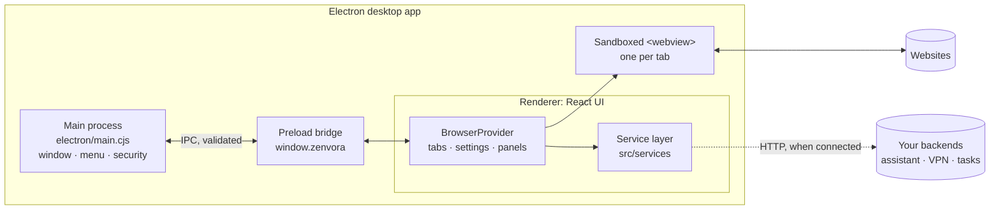

- **Main process** creates the window, builds the menu (which carries the keyboard shortcuts), validates every IPC
  message and applies security settings to each web view.
- **Preload bridge** exposes a fixed set of functions (`minimize`, `toggleMaximize`, `close`, `allowCertHost`,
  command and new-tab events). The UI has no Node.js access.
- **Renderer** is the React app. Tab state is a pure reducer (`src/state/tabs.ts`) that is unit-tested.
- **Web views** load real pages in the desktop app. In the web preview they are replaced by a placeholder and a
  timed loading state.
- **Service layer** separates the interface from data sources, so sample data and real backends are interchangeable.

---

## 🔒 Security

- Web pages run in sandboxed views with `contextIsolation`, no Node.js integration and no preload script; these
  settings are enforced in the main process for every view, whatever the page requests.
- Only `http(s)` pages load in web views. Other schemes are blocked; `mailto:` and `tel:` links go to the OS.
- New-window requests become tabs, never extra windows. The app's own window can't be navigated away.
- Certificate errors block the page. *Continue (unsafe)* allows only that host, only for the current session.
- All site permission requests (camera, microphone, location, notifications…) are denied until permission
  handling is connected to the Privacy panel.
- The UI ships with a strict Content Security Policy, and fonts are bundled, so startup makes no third-party requests.
- No AI provider keys are stored in the app; they live on your assistant server. The app stores only the server
  address and its access token, in local settings on the device.
- The assistant server never stores questions or page text, rate-limits requests and requires the access token when one is set.
- Page text sent to the AI is wrapped and labelled as untrusted, and the model is told not to follow instructions inside it.
- Only one copy of the app runs at a time; opening it again focuses the existing window.

Found a vulnerability? Please report it privately through [GitHub](https://github.com/Mostafijemon24) rather than opening a public issue.

---

## 🧑‍💻 Development

```bash
cd app
npm test             # 25 unit tests: URL handling, tab reducer, services, assistant connection

cd ../server
npm test             # 12 tests against fake Claude / OpenRouter endpoints (no keys needed)
npm run typecheck
npm run build
```

Guidelines:

- Keep tab and navigation logic in the reducer (`src/state/tabs.ts`) and cover changes with tests.
- New backend-dependent features get an interface in `src/services/types.ts` plus a sample implementation, so the
  UI works before the backend exists.
- Use the design tokens in `src/styles/tokens.css` (`--accent`, `--ink`, `--surface`, …) instead of hard-coded colors,
  so light, dark and accent themes keep working.
- The desktop shell is plain CommonJS (`electron/*.cjs`); validate every new IPC message in `main.cjs`.

CI runs the app tests, a production build and the server tests on every push to `main` and on every pull request.

---

## 🩺 Troubleshooting

| Problem | Fix |
|---|---|
| `npm install` fails downloading Electron | Behind a proxy, set `ELECTRON_GET_USE_PROXY=1` and your `HTTPS_PROXY`, then retry |
| Desktop app opens a blank window | Run `npm run build` first; `npm run electron` loads `app/dist` |
| Every site shows *can't be reached* | Check your internet connection or proxy. The error code on the page comes from the engine (for example `ERR_INTERNET_DISCONNECTED`) |
| macOS says the app is damaged or can't be opened | Use **System Settings → Privacy & Security → Open Anyway**; for a download that is still quarantined, run `xattr -dr com.apple.quarantine /Applications/Zenvora.app` |
| AppImage won't start on Ubuntu 22.04+ | `sudo apt install libfuse2` |
| Linux: sandbox error when starting from a terminal as root | Run as a normal user; root needs `--no-sandbox` |
| Settings won't stay saved | Private browsing or blocked site data in the web preview; the desktop app always saves |
| A `.dmg` can't be built on Linux or Windows | Expected; use the release workflow, which builds on macOS |
| Assistant: *Can't reach the server* | Check the address (with `http://` or `https://`), that the server is running (`/health`), and firewall/HTTPS settings |
| Assistant: *rejected the access token* | The token in Settings must equal `ZENVORA_ACCESS_TOKEN` on the server |
| Assistant: *not configured on the server* | That provider's API key is missing in the server's environment; restart after adding it |
| Assistant: *model was not found* / *rejected the request* | Check the model ID; leave the Model field empty to use the server default |
| Assistant says a page's text is not available | Open that tab once so it loads, then ask again |

---

## ⚠️ Known limitations

- Tasks, VPN, Privacy details, Page analysis and the Downloads panel use sample data in v0.2.
- Assistant answers arrive all at once (no streaming yet), and Translate works on the shared page rather than a text selection.
- Site permissions are always denied; the Privacy panel's per-site choices are not yet applied to the engine.
- History, bookmarks and open tabs are not yet saved between launches (settings are).
- The *On startup* and *Suspend inactive tabs* settings are saved but not applied yet, and tabs can't be pinned from the interface yet.
- Releases are not code-signed or notarized yet.
- Automatic updates are not wired in yet; update metadata is already published with each release.
- Linux builds are x64 only.

---

## 🗺 Roadmap

- Session restore: tabs, workspaces, history and bookmarks saved between launches
- Streaming Assistant answers and a local-model (Ollama) provider
- Task engine running real, approved steps in hidden web views
- Real download manager on top of the engine's downloads
- Permission prompts wired to the Privacy panel
- WireGuard configuration import for the VPN
- Signed and notarized installers with automatic updates
- Linux arm64 builds

---

## 👥 Contributors

- [Mostafij Emon](https://github.com/Mostafijemon24)

See the full list on the [contributors graph](https://github.com/Mostafijemon24/Zenvora-Browser/graphs/contributors).

---

## 📄 License

**Proprietary software. All rights reserved.** © 2026 Mostafijemon24.

This repository is not open source. No one may use, copy, modify, distribute, host or sell any part of it without prior written permission. See [LICENSE](LICENSE) for the full terms.

<p align="center"><sub>Zenvora: a browser that helps, and tells you exactly what it's doing.</sub></p>
